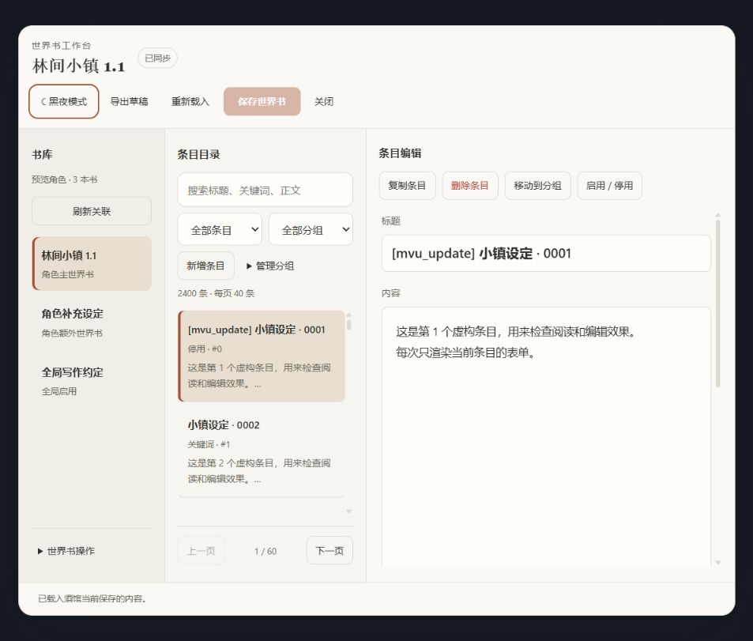
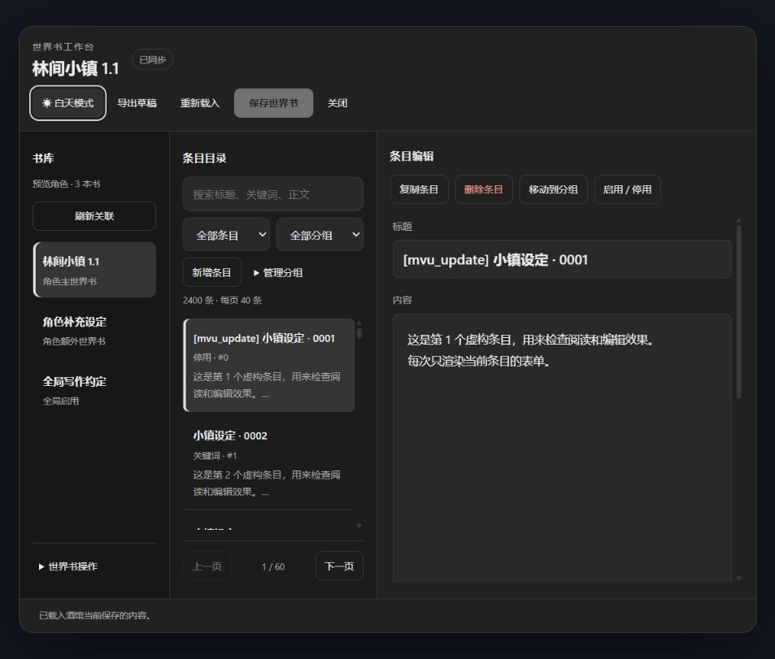
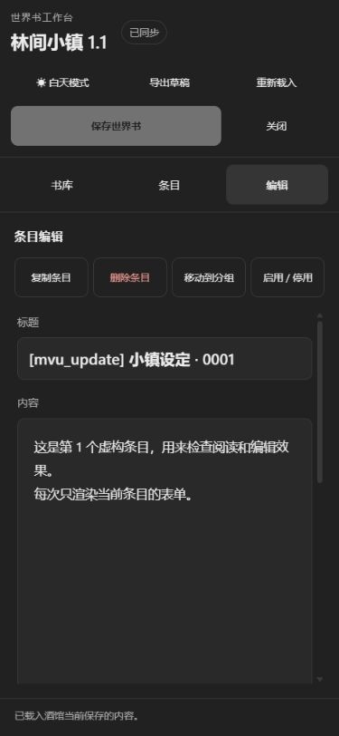
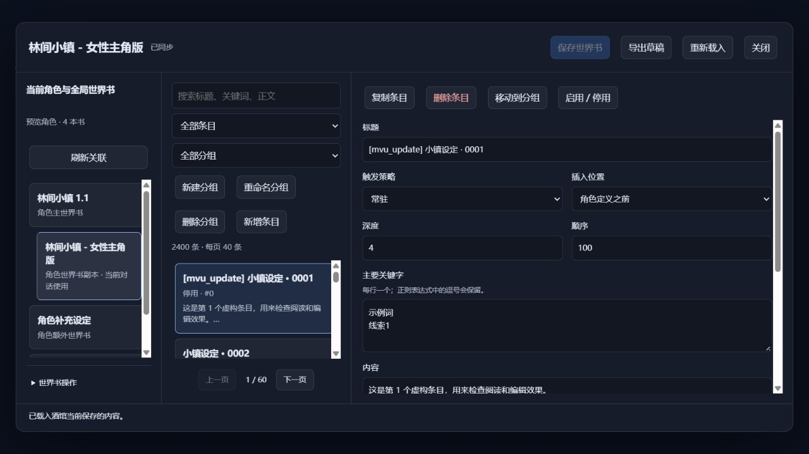

# SillyTavern 世界书管理扩展 0.3.4

针对本机 SillyTavern 1.18.0 编写的通用前端扩展。无需酒馆助手，不修改卡的角色正文，也不执行世界书中的代码。

GitHub 仓库：<https://github.com/hazuki7a/sillytavern-worldbook-manager>。

0.3.4 适配 TauriTavern 2.3.0：其世界书列表来自 `/api/settings/get` 的 `world_names`，没有桌面 1.18.0 的 `/api/worldinfo/list`。现在按宿主分别读取列表，收到 HTML 或无效 JSON 时显示失败接口，不继续写入；支持扩展部署子路径，以及原生应用备份路径的 URL 解析。版本对应源码已核对，尚未在真实手机应用验收。错误不是角色卡内容损坏，不需要重导所有卡。

0.3.2 更新 UI：白天/黑夜主题可切换并在本浏览器记忆；正文紧随标题；移动端使用书库、条目、编辑三个工作区，分组操作收进菜单。世界书读写与关联行为保持原样。

0.3.3 在酒馆扩展设置面板增加“检测扩展更新”：显示当前加载的程序版本，使用酒馆原生 Git 版本接口检查安装目录对应的远端分支，区分已同步、发现更新、检测失败/超时和非 Git 安装。不自动安装；有更新时请在酒馆扩展管理中更新，再刷新网页。检测会让服务器执行 git fetch，仅获取远端信息，不拉取并应用源文件。ZIP/手动复制安装无法进行原生 Git 检查，请从仓库获取新版或用仓库链接安装。此检测与角色卡内世界书自动更新独立。

以下截图使用虚构测试数据：





## 做什么

- 替换卡后、打开角色面板或切换聊天时，只检查当前角色卡内嵌世界书，不扫描其他已加载的卡。
- 首次遇到一张卡只记录基准，不导入、覆盖、删除世界书，也不创建备份。首次安装无法区分作者更新与玩家自己的修改；需要立即修复现有书时，点击“检查并更新当前卡”并确认。
- 建立记录后，卡内世界书内容改变时自动更新；只有本地世界书发生改变不会触发自动覆盖。
- 有旧书时先备份并回读验证，再导入新版、保存并回读角色关联，最后删除不同名的旧书。
- 同名更新通过备份后覆盖实现，不先删除再创建，避免失败时角色找不到世界书。
- 旧书在全局、其他角色、额外角色世界书、用户角色或聊天中仍有关联时，会保留并说明。新书名称已被其他用途使用时，停止覆盖。
- 卡内没有内嵌世界书时不删除任何书。空世界书会再次要求确认。
- 不会按名称前缀批量删除书。安装前丢失的旧书关联无法凭空找回。

## 世界书编辑器

加载后有“世界书”悬浮入口，点击打开管理器；可拖动，位置按浏览器记住，屏幕大小变化时夹回可用范围。也可以在扩展设置里点击“打开世界书编辑器”。左侧只显示当前角色的主世界书、额外关联世界书、本扩展为当前角色创建的独立副本，以及全局已启用的世界书；同一本书合并用途标签。副本缩进显示在主书下面。

中间可搜索标题、关键词和正文，按启用状态、分组筛选，每页只显示 40 条。右侧只显示当前条目的七项：标题、触发策略、插入位置、深度、顺序、主要关键字、内容。触发策略可选常驻、关键词触发、向量检索；关键词模式仍保留原辅助词等隐藏设置。停用/启用在条目工具栏操作。其他原有字段和其他插件数据保留。支持新增、复制、删除条目和导出草稿。

分组是界面整理，不是原生“包含组”，不改变触发顺序。初次显示时，标题带 MVU、[initvar] 或 [updatevar] 的条目归入 MVU，其余归入默认；可以新建、重命名、删除自定义组、移动条目。保存世界书后分组保存在书的扩展字段里。删除组只将条目移回默认组，不删除条目。

### 世界书操作

左侧“世界书操作”菜单提供：

- 创建世界书副本：复制所选角色主书或副本当前已保存的内容，新建一本独立世界书。自定义名称，默认“原书名 - 副本1”，重名递增；不覆盖重名文件。“绑定到当前对话”默认不勾选。
- 当前对话使用所选书：将主书或副本绑定到当前对话并保存选择；仅该对话加载这个版本，排除同组原书/其他副本，保留其他全局、额外、用户角色世界书。即使同组其他版本在全局启用，也会在这个对话中排除。原生对话绑定本来是叠加，本扩展通过加载事件实现组内替代。
- 解除对话版本选择：恢复之前的原生对话世界书（若仍存在），恢复角色主书正常参与。玩家后来在原生界面更改了对话绑定时，不覆盖玩家的新选择。
- 设为角色主书：改变角色的主书关联，作用于没有单独选择版本的对话。已有对话选择优先。
- 导入全局世界书：选择 JSON、确认条目数量与书名后新建并全局启用；同名停止，不静默覆盖。
- 导入角色世界书新版：选择 JSON、确认条目数量与名称。备份旧书、保存回读、关联新版后，独用旧书删除，共享旧书保留；玩家副本不会被覆盖，对话已选择的副本保持原样。

导入支持原生世界书 JSON、角色卡 JSON 中的 character_book、标准 character_book 条目数组；PNG 和其他平台书请先通过酒馆原生导入转换。操作前先保存或放弃当前草稿，防止复制的是尚未保存的内容。新建/绑定失败会说明已完成的部分，已创建的新书保留，避免丢失数据。

副本关联和悬浮位置属于扩展管理数据：位置仅在当前浏览器；副本家族登记在当前账户扩展设置，选择版本在对话元数据中。世界书本身为酒馆正常世界书文件。

禁用或卸载扩展后，酒馆原生对话绑定仍在，但“排除同组其他版本”的行为随扩展停止，原书与副本可能叠加；停用前请解除本扩展的对话版本选择。不会修改原书条目的全局启用状态来影响其他对话。群聊暂不提供单角色副本替代。

修改先留在草稿，点击“保存世界书”才写入同一本酒馆世界书。保存前备份、检查是否在别处发生修改，保存后重新读取核对并刷新缓存。不会另建一份编辑器专用世界书，也不会自动把角色世界书改为全局启用。修改的是已导入的世界书，不回写磁盘上的原始 PNG 卡文件。

原界面的修改会通过酒馆事件同步；窗口重新获得焦点时也会重新检查。有未保存草稿时保留草稿并提示冲突，不直接覆盖。切换角色导致书不在范围内时，暂停保存，仍可导出旧草稿。正在编辑同一本书时，自动卡更新会暂缓，可保存/放弃草稿后再手动检查卡更新。

分页和单条表单减少一次创建的页面元素；2,400 条虚构数据的浏览器预览已验证。尚未测量真实大世界书在本机酒馆里的速度，不能据此承诺彻底解决所有卡顿。

## 安装

文件已经准备好，尚未安装进实际酒馆。关闭/刷新酒馆前请完成正在生成的回复。

在 PowerShell 7 中先预览安装路径：

```powershell
pwsh.exe -NoLogo -NoProfile -NonInteractive -File "D:\card\xt\st-worldbook-updater\Install.ps1"
```

确认后安装到 `data/default-user/extensions/st-worldbook-updater`：

```powershell
pwsh.exe -NoLogo -NoProfile -NonInteractive -File "D:\card\xt\st-worldbook-updater\Install.ps1" -Install
```

默认安装只作用于 `default-user`。如果使用其他酒馆账户，增加 `-UserHandle "你的账户名"`。
也可以把这个目录复制到所用账户的 `data/<账户>/extensions/st-worldbook-updater`。

刷新酒馆网页，在扩展管理中确认“角色卡世界书更新器”可见且已启用。
设置面板有“检查并更新当前卡”、自动检测开关和“打开世界书编辑器”；悬浮入口与设置入口打开同一个界面。
安装脚本遇到已有扩展目录会停止，避免直接覆盖。升级已有版本时先备份旧扩展目录，再复制本包的运行文件；已有酒馆设置和世界书备份独立存放。
首次使用建议准备一张测试卡，检查同名更新、改名更新和备份下载，再用于日常卡。

## 备份与恢复

备份为可直接导入的世界书 JSON，放在当前账户的 `data/<账户>/user/files/worldbook-backup-*.json`。
它不是另一本启用的世界书，不会出现在世界书列表，也不会参与提示词。
扩展设置里显示最近 20 份下载链接；更早的备份仍留在磁盘上，不会自动清理。

恢复旧书：下载对应备份，在酒馆世界书管理中导入，设置所需书名，再在角色面板选择该书。
同名恢复会覆盖当前新版，应先确认需要恢复哪个版本。

## 范围与限制

- 检测只针对当前打开角色。新导入但从未记录基准的卡，第一次打开只记录基准；可手动检查来导入内嵌书。切换角色会中止上一张卡尚未提交的更新。
- 首次安装只有现在的绑定可供判断。若你早已更新卡、且新版卡已经覆盖了旧关联名称，扩展无法猜出哪个无关联文件是旧书；不会扫名字批量删除。
- 已有关联的聊天/额外世界书不会被悄悄改写。它们引用旧书时，旧书保留；面板明确提示。可以先手动解除这些旧关联，再使用“检查并更新当前卡”。
- 新版导入/自动更新是整本替换，不合并条目；备份用于恢复玩家修改，独立副本保留。
- 共享检查使用酒馆能返回的角色列表和聊天元信息。损坏或宿主 API 未返回的存档，以及其他脚本在代码中硬写的书名，无法完整识别。
- 使用内容比较、写前复核、回读和同浏览器 Web Locks 降低冲突。宿主没有原子比较后写入接口，不保证另一台设备/浏览器同时改书时的事务隔离；更新期间请避免同时编辑同一本书。
- 只核对了本机 1.18.0 的具体源码；最低版本字段不是“所有更高版本已经测过”的保证。酒馆升级后要复核两个内部模块的接口。
- 禁用会注销监听并停止尚未执行的后续操作，已经提交服务器的请求不能撤销。已完成的书更新、删除和备份不会因卸载恢复。

## 验证

核心事务离线测试：

```powershell
pwsh.exe -NoLogo -NoProfile -NonInteractive -Command "node 'D:/card/xt/st-worldbook-updater/tests/core.test.js'"
```

安装前验证本机接口：

```powershell
pwsh.exe -NoLogo -NoProfile -NonInteractive -File "D:\card\xt\st-worldbook-updater\Verify-Source.ps1"
```

编辑器离线测试：`node tests/editor.test.js`。

静态证据：模块语法、manifest、本机接口检查通过，90 项测试通过：事务 20、编辑器 20、启动 10、管理 22、本机原生加载 3、扩展更新检测 7、HTTP/Tauri 兼容 8。本机原生函数测试会在没有相应源码的机器上跳过，也可通过 ST_WORLDINFO_SOURCE 指定文件。
浏览器隔离预览通过范围过滤、分页、搜索、保存后重新读取、概率校验、外部同步、冲突拦截及范围变化时保留草稿。预览仅修改合成数据，不访问真实酒馆。
0.3.0 浏览器预览已检查副本创建/可选绑定、原书独立、两种文件导入、七项字段、分组保存和 375px 布局。本机原生加载函数离线验证了对话副本排除原书。预览图：



尚未验证：真实酒馆扩展更新、实际聊天服务器持久化、原生替换卡流程、真实备份下载、热禁用/启用与实际提示词。需要在实际酒馆用测试对话检查，见 NEXT.md。宿主保存聊天的接口可能吞掉保存错误，本版额外读取保存的聊天核对绑定元数据；实机仍需刷新和切换验收。
这些需要在真实酒馆中使用测试卡验收，不能把离线通过当成已经实机通过。
- 重命名所选世界书：先备份，保存并回读新文件，更新角色主书、额外书、全局选择、用户角色、当前对话和本扩展副本登记。重名会停止，不覆盖其他书。其他单角色对话在打开时沿改名记录迁移并保存；仍被旧存档引用时保留旧名兼容文件，不贸然删除。群聊仍保留旧名文件，不做单角色迁移。中途失败会说明部分完成状态，并保留新旧文件。
- 关闭所选书全局启用：只取消全局选择，世界书文件、角色关联和对话关联保留。纯全局书关闭后从本界面列表移除；同时绑定当前角色的书仍显示角色用途。需要重新全局开启，可使用酒馆原生全局选择器。
